<div align="center">


# Astraeus

**A native dynamic island for Windows that drips open from the edge of your screen.**

[](https://github.com/Icetist/Astraeus/releases/latest)
[](https://github.com/Icetist/Astraeus/releases)
[](https://github.com/Icetist/Astraeus/actions/workflows/release.yml)


[Features](#-features) •
[Screenshots](#-screenshots) •
[Performance](#-performance) •
[Installation](#-installation) •
[Configuration](#%EF%B8%8F-configuration) •
[Building](#%EF%B8%8F-building-from-source) •
[FAQ](#-faq)


</div>

Astraeus lives in a thin strip at the edge of your screen, at the top by default or as a sidebar on the left or right. Hover it and a liquid panel springs out with your music, quick toggles, system stats and everyday tools. Move away and it tucks itself back in, hands the GPU back and goes back to using almost nothing.

No Electron, no web view, no runtime to install. Just one small native executable written in C++ with Direct2D and DirectComposition.

<p align="center"><sub>If Astraeus makes your desktop a little nicer, consider leaving a ⭐. It genuinely helps.</sub></p>

## ✨ Features

- **Media player and fullscreen lyrics.** Album art, a visualizer that swells with the music, and a fullscreen player with time-synced lyrics that light up word by word, spread across two monitors if you have them.
- **Live.** Scores, live stats and big results for the sports you pick, plus world news, on a page of its own.
- **Quick toggles and control centers.** Wi-Fi, Bluetooth, volume, brightness and a volume mixer, with devices and networks you connect to right in the panel.
- **The island.** A small pill with what's playing over full-screen apps, or always on with the clock and two small widgets.
- **Colors that follow you.** Dark, light, glass, custom or HaloBar's look, with the palette pulled from your wallpaper or the album art.
- **Lightweight.** Nothing renders while closed, and the GPU is handed back seconds later.

<details>
<summary><b>More features</b></summary>

- **Media player** with album art, a wavy seek bar and soft light that swells up from below with the music, bass to treble. Works with Spotify, browsers, Media Player and anything else that talks to Windows media controls. Loop and restart work even for players that don't offer them, like YouTube in Firefox-based browsers. The cover turns over like a card when the song changes, a compact layout puts a smaller cover beside the song, and album art, the visualizer and music in the pill can each be switched off.
- **Fullscreen player.** Click the album cover to fill the screen with the cover, the song and a glow that moves with the music. Click it again or press Esc to leave, and you're back on the Media page. Opened from HaloBar's album cover, it goes back to HaloBar's own player instead. Its controls fade away while the mouse rests, or stay up if you'd rather. With two monitors, press **S** to spread it across both, the cover on one and the lyrics on the other, and **W** to swap them; both keys can be changed in Settings.
- **Synced lyrics.** For songs from music apps and sites (Spotify, Apple Music, YouTube Music, Tidal, Deezer, SoundCloud and more, in their apps or in the browser), the fullscreen player shows time-synced lyrics beside the cover, even for songs Spotify has no lyrics for. Lyrics light up word by word, in a rounder type made for singing along, from three lyrics sources, the rest drift soft and out of focus, and you can click any line to jump there. Can be turned off in Settings.
- **Live.** An optional page (off by default) with scores, live stats and the last big result for 3 to 5 sports of your choice, men's or women's: football, cricket, basketball, F1, tennis, golf, FIDE chess, figure skating with real ISU scores and many more, plus world news. It fetches only while the page is on screen. Change your sports any time under **Advanced** in Settings.
- **The shelf.** Drag files or text onto the top of the screen (or the open panel) and the panel drops open on the Shelf page to keep them, up to ten, newest first. Drag a card back out to drop it anywhere, or tap it to copy it: a note's text, or the file itself. Only paths are kept, never copies, and nothing touches the disk unless you switch on **Keep after restart**.
- **Shared audio.** Play the same sound on several outputs at once, Bluetooth and wired, each with its own delay and volume to keep them in sync.
- **Quick toggles** for Wi-Fi, Bluetooth, microphone and output device (or power mode and battery on laptops), plus volume, mic and brightness sliders. Rest the mouse on the battery tile for its capacity, wear, charge rate and time left.
- **Battery pills.** On a laptop a pill drops when you plug in or unplug, and once when the battery runs low (20% by default, anywhere from 5 to 50%), even in Do Not Disturb. Windows tells Astraeus when power changes; nothing polls.
- **Volume mixer.** Click the speaker on the volume slider for a small mixing console: a fader and mute for every app making sound, next to the master.
- **Bluetooth control center.** Right-click the Bluetooth tile and your devices orbit your PC: connected ones close in with their battery levels, paired ones further out, new finds gliding in while it scans. Click a device to connect, disconnect or pair it, or hold to forget it.
- **Wi-Fi.** Right-click the Wi-Fi tile, or press **Networks** on the Network page: nearby networks ride the arcs of a big Wi-Fi symbol, closer the stronger they are. Join one with its password right in the panel, or hold to forget a saved one.
- **Live system stats:** CPU, GPU, memory, top processes, network throughput and latency, local and public IP, all with smooth sparklines.
- **Tools:** lock, sleep, sign out, restart and shut down (destructive actions are press-and-hold), a timer, a stopwatch with laps and focus sessions (focus and break rounds with notifications), a screen color picker that copies the hex code, a screenshot shortcut, keep-awake, energy saver, airplane mode and a shortcut to the Windows notification center. Pick which quick tiles show and in what order, like widgets: right-click them on the Tools page (or use **Tools tiles** in Settings), drag to reorder, **×** to take one off and **+** to bring one back. While a timer, stopwatch or focus session runs, a small round bubble beside the pill counts it down; click it to go straight to that tool.
- **A keyboard shortcut.** Win+Alt+A opens the panel on the screen your mouse is on; arrow keys and 1 to 6 move between pages and Esc closes it.
- **Weather and a calendar.** Weather for your location, in Celsius or Fahrenheit. Type a city in Settings (add its country or region, like `Paris, Texas`, to pick between places with the same name) and your IP address is never used to look you up at all. Click the weather card for a month at a glance, with holidays from around the world lit up and a greeting when you hover them, and click the weather there for the next hours and days. Connect Google Calendar, Outlook or iCloud by copying your calendar's private link, and your events show up on it, stored encrypted and shared with HaloBar.
- **Colors that follow you.** The palette is pulled from your wallpaper, or from the album art of whatever is playing, or from any accent you pick. The accent can also follow Windows' own accent color, live. Five looks: dark (the default), light, glass (a live frosted blur of whatever is behind the panel, with a tint that deepens over bright pages so white text stays readable and eases back over dark ones), custom, where a color wheel lets you pick any accent and any background, with text that turns white or black to suit, and HaloBar, which wears whatever HaloBar wears. On the solid looks an opacity slider lets the desktop show through; on glass the slider sets the blur instead. While it wears HaloBar's look, the opacity and blur are HaloBar's too, and its own slider steps aside; HaloBar does the same while it follows Astraeus.
- **Settings you touch.** Pick the edge it lives on, which monitor (or all of them, with the open panel and the resting pill following your mouse from screen to screen), your accent color and look from small pictures of the real thing. Reduce motion calms every animation. Make everything 80 to 130% of its size, keep the fullscreen player's controls up or let them fade at rest, choose which pages the rail shows and in what order, open on the last page or one you choose, and export your settings to a file, import them on another PC, or reset everything to defaults. Power, weather, volume and brightness, backup and Live sit together under **Advanced**.
- **The island.** Over a maximized window, or tiled windows that fill the screen, a small pill shows what's playing instead of dropping the whole panel over your work. It can stay a moment, minutes, or always while music plays. Turn on **Pill on the desktop** (off by default) and it also stays up whenever no app window is under it, after Win+D or once the last window closes; it goes again when a window comes back under it. Turn on **Always show the pill** and it stays up with the clock between two small widgets of your choice (weather, battery, CPU, memory or network); it repaints only when one of them changes, once a minute for the clock. Windows notifications can arrive as pills too, and when HaloBar is running with its notification pills on they always do, in place of its own. Do Not Disturb, in Settings and on the Tools page, quiets them, and is shared with HaloBar.
- **Volume and brightness pill (experimental).** Off by default. Switch on **Replace Windows volume popup** and a pill shows every volume and brightness change. While it's on, Astraeus takes the volume keys before Windows sees them, so Windows' own volume popup stays away; the brightness keys still bring up Windows' popup alongside it.
- **A hello at sign-in.** When it starts with Windows, the Home page drops down to greet you and goes back up the moment you move the mouse.
- **Gets out of the way.** Hides itself when a game or video goes fullscreen. When it's on every screen, the pill moves straight to a screen without a game.
- **Stays up to date.** New releases install themselves silently in the background, and only after their SHA-256 matches the one published with the release. **Check for updates** in the tray menu looks right away.
- **Lightweight.** Nothing renders while the panel is closed, the GPU is released after a few seconds and the process drops into Windows efficiency mode. Glass, shared audio and the fullscreen player only load while you use them.

</details>

## 📸 Screenshots

<table>
  <tr>
    <td width="50%"></td>
    <td width="50%">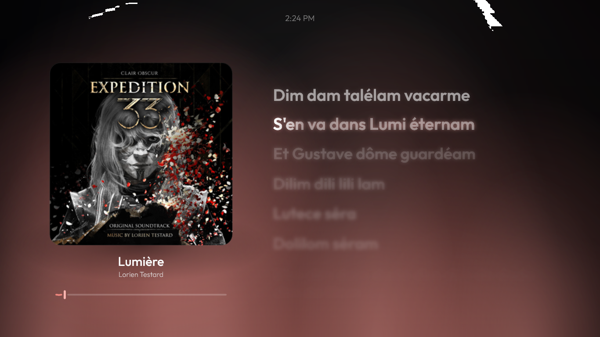</td>
  </tr>
  <tr>
    <td align="center"><b>Media player</b></td>
    <td align="center"><b>Fullscreen lyrics</b></td>
  </tr>
  <tr>
    <td width="50%"></td>
    <td width="50%">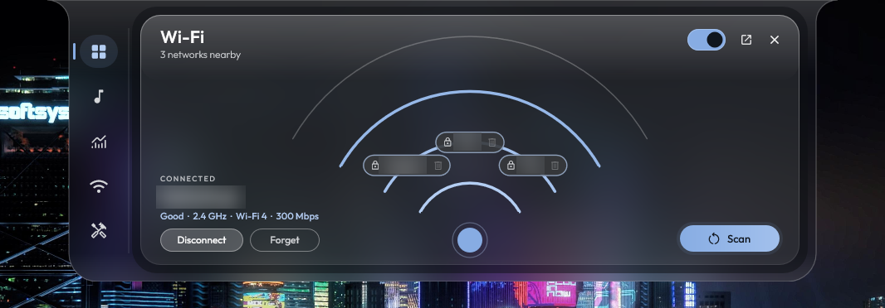</td>
  </tr>
  <tr>
    <td align="center"><b>Bluetooth control center</b></td>
    <td align="center"><b>Wi-Fi</b></td>
  </tr>
  <tr>
    <td width="50%">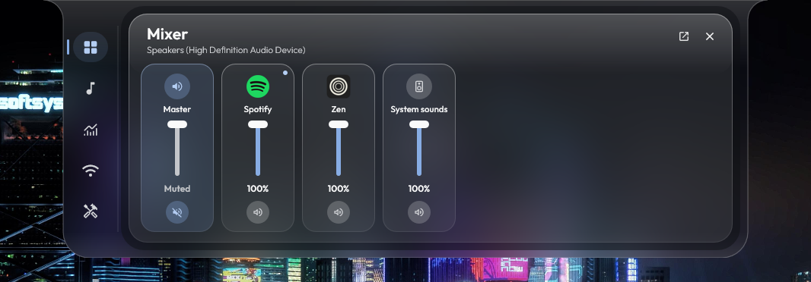</td>
    <td width="50%">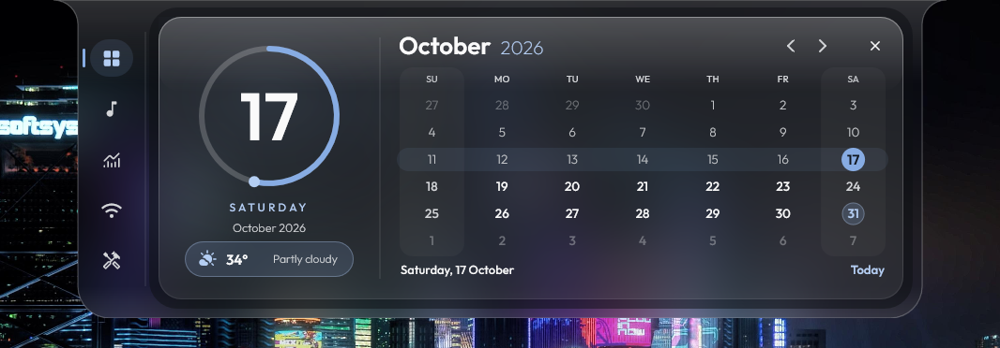</td>
  </tr>
  <tr>
    <td align="center"><b>Volume mixer</b></td>
    <td align="center"><b>Calendar</b></td>
  </tr>
  <tr>
    <td width="50%">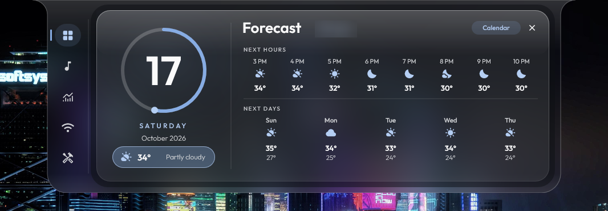</td>
    <td width="50%">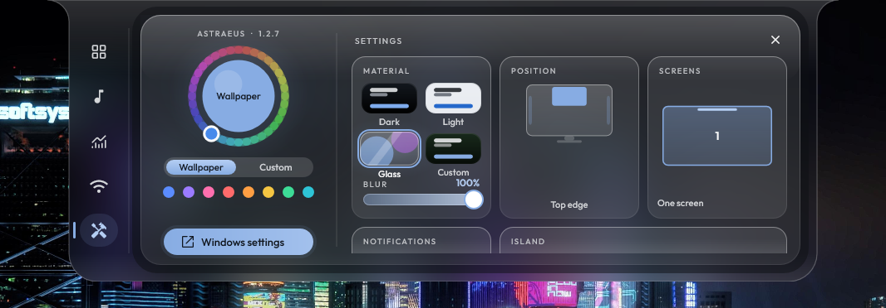</td>
  </tr>
  <tr>
    <td align="center"><b>Forecast</b></td>
    <td align="center"><b>Settings</b></td>
  </tr>
  <tr>
    <td width="50%"></td>
    <td width="50%">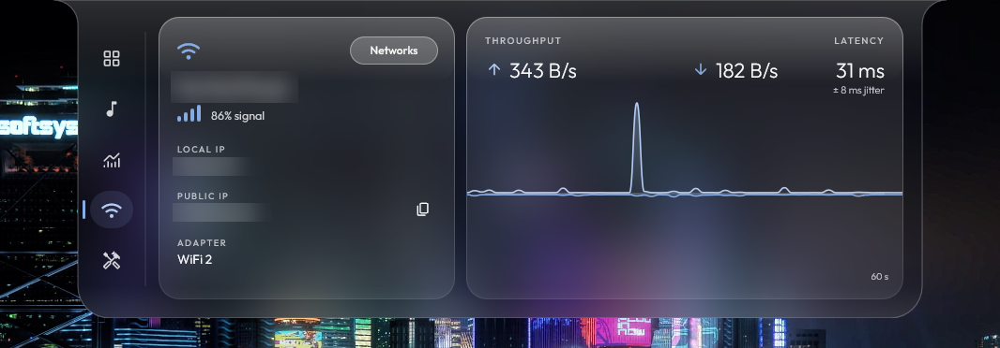</td>
  </tr>
  <tr>
    <td align="center"><b>System</b></td>
    <td align="center"><b>Network</b></td>
  </tr>
  <tr>
    <td width="50%"></td>
    <td width="50%"></td>
  </tr>
  <tr>
    <td align="center"><b>Tools</b></td>
    <td align="center"><b>The Island pill</b></td>
  </tr>
</table>

### Four Themes, Infinite Possibilities

Glass (above), Dark, Light and Custom, where a color wheel picks any accent and any background.

<table>
  <tr>
    <td width="50%">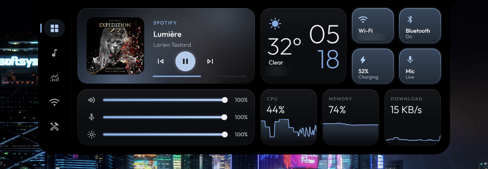</td>
    <td width="50%">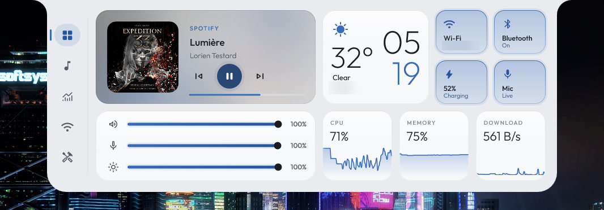</td>
  </tr>
  <tr>
    <td align="center"><b>Dark</b></td>
    <td align="center"><b>Light</b></td>
  </tr>
  <tr>
    <td width="50%">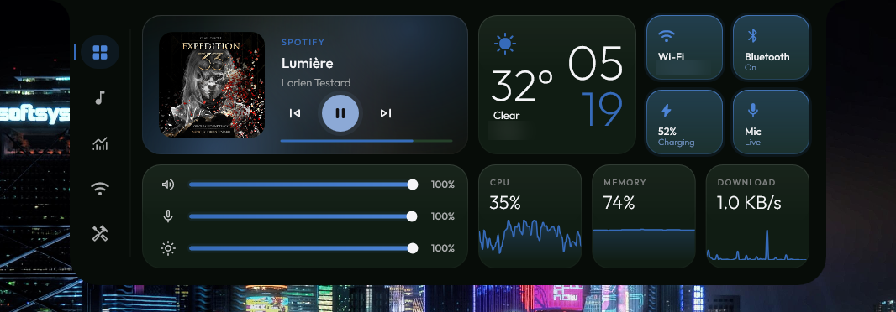</td>
    <td width="50%">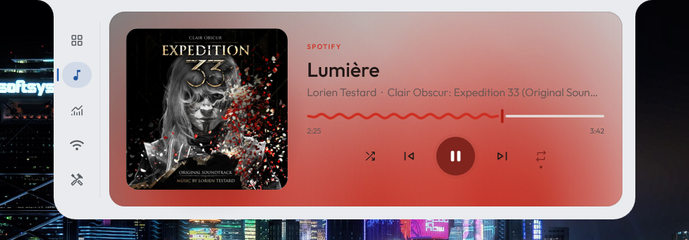</td>
  </tr>
  <tr>
    <td align="center"><b>Custom</b></td>
    <td align="center"><b>Light, with the album's colors</b></td>
  </tr>
</table>

## ⚡ Performance

Astraeus is built to cost nothing while you are not looking at it. Measured on a modest laptop
(Intel Core i5-4210U, integrated graphics, 8 GB RAM, Windows 11, 1366x768):

| | Closed | Open | After closing |
| --- | --- | --- | --- |
| **Memory (as Task Manager shows it)** | 9 MB | ~23 MB | ~2 MB |
| **CPU (share of one core)** | 0.08% | 1.7% | ~0% |

| | |
| --- | --- |
| **Executable size** | 1.9 MB, single file, fonts embedded |
| **Install size** | 1 file, no runtime, no installer |

That's light enough for 2 GB machines and entry-level Celeron and Pentium laptops: closed, it uses about a tenth of a percent of 2 GB.

How it stays this light:

- Frames are only drawn while something is actually moving. A closed panel renders nothing at all.
- Direct3D, Direct2D and the swap chain are released a few seconds after the panel closes and rebuilt on demand when it opens again. On release the driver is told to drop its buffers and freed memory goes straight back to Windows.
- Direct2D's own cache is capped and cleared after the panel closes, so a long session never grows it.
- A pill on its own keeps only a pill-sized strip of graphics memory instead of the whole panel's.
- On a PC that can't keep up, animation settles on a steady rate it can hold instead of stuttering, and tries full speed again later.
- While closed, the process runs in Windows 11 efficiency mode (EcoQoS) with low memory priority, so Windows can park it on efficiency cores and trim it first.
- Stats, Bluetooth and network workers only run while the panel is open, and the system gauges, process list and latency only while their own page shows. Bluetooth does nothing at all until you open its menu, and while closed, stats are sampled only every 5 seconds.
- The glass blur, shared audio, the fullscreen player, the audio analyser behind the visualizer and the notification watcher are built only when you use them and torn down afterwards.
- The once-a-second housekeeping timer is coalescable, so Windows can batch its wakeups with others.
- Icon fonts are subset to the glyphs that are actually used (3 MB down to 33 KB) and served straight from the executable without copying.
- A resting island pill draws its still parts once into a cached image and repaints only its four little bars, and every frame works and presents only the part of the surface the window shows.
- Lyrics are looked up once per song from three sources at once over reused connections, kept on disk for the last 300 songs so a replay needs no network, and the soft focus of each line is baked once instead of blurred every frame.
- The volume mixer reads apps only while it's open.
- The music glow and the sparklines stay inside their rounded cards by the card's own shape, not an offscreen layer per frame, and icons reuse their laid-out glyphs: the Home page draws a frame in about a quarter of the time it used to.
- Battery and power changes, Windows' accent color and edits to `astraeus.ini` all arrive as notifications from Windows; nothing checks for them on a timer. The volume pill's listeners and key hook exist only while that option is on. The same goes for **Pill on the desktop**: Windows reports focus changes, minimizes and finished moves, and Astraeus looks under the island once they settle.
- Shelf previews are made on a short-lived thread that ends when the last one is done.
- The GPU counter behind the System page's gauge costs seconds of CPU to open, so it's opened on a background thread the first time that page shows, never at launch. Astraeus is up in well under a second.
- A pill that stays up after the panel closes moves over to a fresh graphics device of its own size, so the memory the open panel used in the graphics driver goes back to Windows.

<sub>Private working set from Windows performance counters, after the app settles. Closed was sampled over 20 seconds, open over 10 seconds with the panel sitting on Home. The very first open of a session is higher (about 44 MB) while fonts, cover art and the forecast load; every later open settles around 23 MB.</sub>

## 📦 Installation

1. Download `Astraeus.exe` from the [latest release](https://github.com/Icetist/Astraeus/releases/latest).
2. Run it. That's it.

On first launch Astraeus asks whether it should start with Windows. Say yes and it copies itself to
`%LOCALAPPDATA%\Programs\Astraeus`, so you can delete the downloaded file whenever you like.

Updates are automatic. Astraeus checks GitHub shortly after launch and every few hours, installs new versions in the background and lets you know with a small banner the next time it restarts.

> [!NOTE]
> The executable is not code-signed yet, so Windows SmartScreen may show an "unknown publisher" warning the first time. Click **More info → Run anyway**.

## 🖱️ Usage

- **Open the panel** by hovering the middle of the edge it lives on (the top unless you moved it), with **Win+Alt+A**, or by clicking the tray icon. Over a maximized window the island pill shows first; click it to open the panel.
- **Close it** by moving the mouse away, clicking the tray icon again or dragging the panel back up.
- **Switch pages** with the rail: Home, Media, System, Network, Shelf and Tools. Hover an icon to see its name. Under **Pages** in Settings, drag them into another order, or hide the ones you don't use with **×** and bring them back with **+**. Scroll or swipe sideways over the rail to move a page at a time; over the pill, scrolling opens the panel on the next page. On Home, the media card, CPU, Memory and Download cards also take you to their pages. The weather card opens the calendar.
- **Fullscreen player:** click the album cover on the Media page. Click it again, press **Esc** or right-click to leave. With lyrics showing, scroll to look around, click a line to jump to it, and press **[** or **]** to nudge the lyrics earlier or later. With two monitors, **S** puts the cover and the lyrics on a screen each and **W** swaps them (change the keys under **Fullscreen keys** in Settings).
- **Shared audio:** open the Bluetooth menu and switch to the **Shared audio** tab.
- **Bluetooth devices:** right-click the Bluetooth tile on the Home page.
- **Volume mixer:** click the speaker icon on the volume slider, or right-click the slider.
- **Wi-Fi networks:** right-click the Wi-Fi tile on the Home page, or press **Networks** on the Network page.
- **Settings:** the **Settings** tile on the Tools page, right-click the rail, or **Settings** in the tray menu, for the look (dark, light, glass, custom), accent color, edge, screens, notification pills, the island, fullscreen lyrics, the status pill, pages, tools tiles, media, display, power, weather city, the volume pill and backups.
- **Shelf:** drag files or text onto the top of the screen. Drag a card out to use it, tap it to copy it, or press **×** to take it off the shelf.
- **Tray menu:** click the tray icon to open the dashboard; right-click it for config, start with Windows, check for updates, restart and exit.

## ⚙️ Configuration

Everything lives in `astraeus.ini` next to the executable. Open it from the tray menu (**Edit config**) and save: changes apply right away, no restart needed. Choices made in the Settings sheet live in the registry; **Export** in Settings writes them, together with the keys of `astraeus.ini`, to a single `.ini` file you can **Import** again.

| Key | Default | Description |
| --- | --- | --- |
| `PanelWidth` / `PanelHeight` | `900` / `340` | Size of the dropdown in DIPs (pixels at 100% scaling). |
| `Fillet` / `CornerRadius` | `26` / `34` | Shape of the curve where the panel meets the screen edge, and of its bottom corners. |
| `HoverOpen` | `true` | Open the panel when the mouse touches the hover zone. |
| `HoverWidth` | `240` | Width of the hover zone at the top of the screen, centered. |
| `HoverDelayMs` / `CloseDelayMs` | `70` / `450` | How long to wait before opening and closing. |
| `Hotkey` | `Win+Alt+A` | The shortcut that opens the panel, like `Ctrl+Shift+Space` or `Win+Alt+F2`; `off` for none. |
| `HideOnFullscreen` | `true` | Hide while a fullscreen app is in front. |
| `ReleaseGpuAfterSec` | `8` | Free GPU memory this many seconds after the panel closes. |
| `Theme` | `wallpaper` | `wallpaper`, or a hex color such as `#B8C4FF`. |
| `AlbumColors` | `true` | Tint the media player with colors from the album art. |
| `Visualizer` | `true` | Let the glow behind the player react to the music. The **Visualizer** switch in Settings takes over once used. |
| `Weather` / `Fahrenheit` | `true` / `false` | Show the weather card and choose its unit. |
| `AutoUpdate` | `true` | Download and install new versions automatically. |
| `PerfLog` | `false` | Write render timings to `perf.log`, handy for performance testing. |

## 🛠️ Building from source

**Requirements:** Windows 10 or 11 and Visual Studio 2022 or newer (or the Build Tools) with the **Desktop development with C++** workload.

From an **x64 Native Tools Command Prompt**, in the repository root:

```bat
mkdir build\obj
rc /nologo /fo build\obj\app.res res\app.rc
cl /nologo /std:c++20 /O2 /GL /Gw /EHsc /MT /W4 /permissive- /utf-8 /MP ^
   /DUNICODE /D_UNICODE /DWIN32_LEAN_AND_MEAN /DNOMINMAX ^
   /Fo:build\obj\ src\*.cpp build\obj\app.res /Fe:build\Astraeus.exe ^
   /link /LTCG /SUBSYSTEM:WINDOWS /OPT:REF /OPT:ICF ^
   user32.lib gdi32.lib shell32.lib shlwapi.lib ole32.lib oleaut32.lib advapi32.lib dwmapi.lib ^
   d2d1.lib d3d11.lib dxgi.lib dxguid.lib dwrite.lib dcomp.lib windowscodecs.lib ^
   pdh.lib iphlpapi.lib wlanapi.lib winhttp.lib bthprops.lib powrprof.lib wbemuuid.lib ntdll.lib windowsapp.lib
```

The result is a single self-contained `build\Astraeus.exe`.

## ❓ FAQ

<details>
<summary><b>How do I uninstall it?</b></summary>

Turn off **Start with Windows** in the tray menu, exit Astraeus, then delete `%LOCALAPPDATA%\Programs\Astraeus`. Optionally remove the `HKCU\Software\Astraeus` registry key, which holds your settings.

</details>

<details>
<summary><b>Does it replace Rainmeter?</b></summary>

For a lot of people, yes. Astraeus covers the usual Rainmeter desktop widgets (media, stats, network, weather, quick toggles) in a single native app with no skins to install, and it is designed to sit at near-zero cost while idle.

</details>

<details>
<summary><b>Why did a keyboard or mouse reconnect right after I disconnected it?</b></summary>

Many keyboards, mice and controllers reconnect on their own the moment you touch them. Windows Settings behaves the same way. Headphones and speakers stay disconnected until you connect them again.

</details>

<details>
<summary><b>Can I turn off automatic updates?</b></summary>

Yes. Set `AutoUpdate = false` in `astraeus.ini` and restart.

</details>

## 🙏 Credits

- [Outfit](https://github.com/Outfitio/Outfit-Fonts) by the Outfit Project Authors, licensed under the [SIL Open Font License 1.1](./LICENSES/Outfit-OFL.txt).
- [Material Symbols](https://github.com/google/material-design-icons) by Google, licensed under the [Apache License 2.0](./LICENSES/MaterialSymbols-Apache-2.0.txt).
- Synced lyrics from [LRCLIB](https://lrclib.net), NetEase Cloud Music and Kugou.

### 🧪 The testers

**[Abrar Awwal](https://www.instagram.com/abrarr.png)** and **[ATK](https://github.com/atkftw)** ran every alpha and beta build before anyone else did. They hit the crashes, found the glitches and broke what could break, so that what reaches you doesn't.
