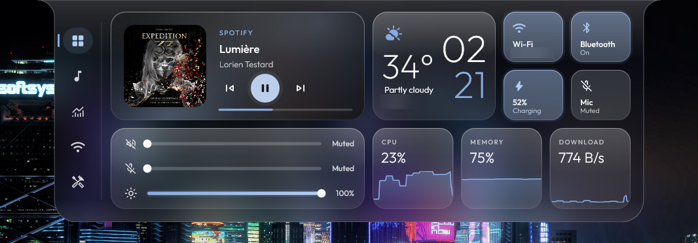
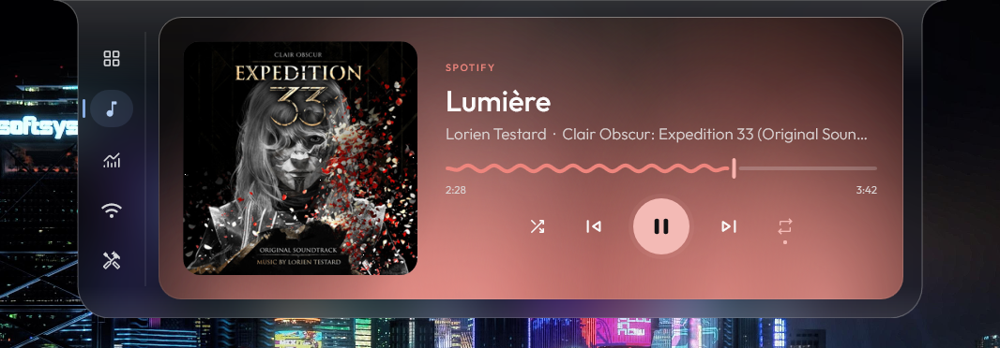
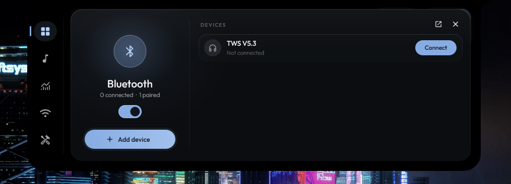
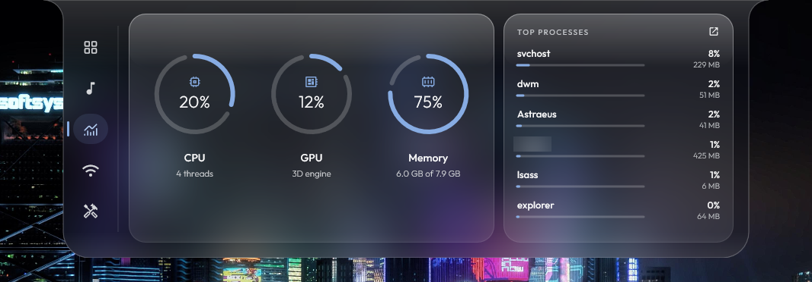
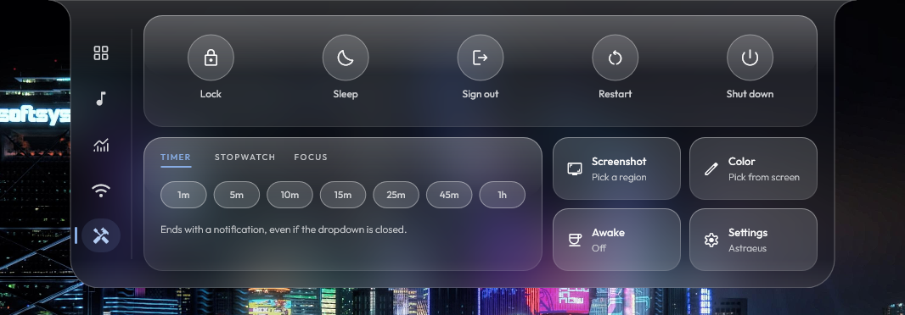

<div align="center">


# Astraeus

**A native bezel dashboard for Windows that drips open from the top of your screen.**

[](https://github.com/Icetist/Astraeus/releases/latest)
[](https://github.com/Icetist/Astraeus/releases)
[](https://github.com/Icetist/Astraeus/actions/workflows/release.yml)


[Features](#-features) •
[Screenshots](#-screenshots) •
[Performance](#-performance) •
[Installation](#-installation) •
[Configuration](#%EF%B8%8F-configuration) •
[Building](#%EF%B8%8F-building-from-source) •
[FAQ](#-faq)



</div>

Astraeus lives in a thin strip at the top edge of your screen. Hover it and a liquid panel springs down with your music, quick toggles, system stats and everyday tools. Move away and it tucks itself back in, hands the GPU back and goes back to using almost nothing.

No Electron, no web view, no runtime to install. Just one small native executable written in C++ with Direct2D and DirectComposition.

<p align="center"><sub>If Astraeus makes your desktop a little nicer, consider leaving a ⭐. It genuinely helps.</sub></p>

## ✨ Features

- **Media player** with album art, a wavy seek bar and a glow that pulses with the music. Works with Spotify, browsers, Media Player and anything else that talks to Windows media controls.
- **Quick toggles** for Wi-Fi, Bluetooth, microphone and output device (or power mode on laptops), plus volume, mic and brightness sliders.
- **Bluetooth control center.** Right-click the Bluetooth tile to see paired devices, connect or disconnect them, scan for and pair new ones, or forget old ones.
- **Live system stats:** CPU, GPU, memory, top processes, network throughput, local and public IP, all with smooth sparklines.
- **Tools:** lock, sleep, sign out, restart and shut down (destructive actions are press-and-hold), a timer with notifications, a screenshot shortcut and keep-awake.
- **Weather** for your location, in Celsius or Fahrenheit.
- **Colors that follow you.** The palette is pulled from your wallpaper, or from the album art of whatever is playing.
- **Gets out of the way.** Hides itself when a game or video goes fullscreen, and can optionally stay visible in screen recordings.
- **Stays up to date.** New releases install themselves silently in the background.
- **Lightweight.** Nothing renders while the panel is closed, the GPU is released after a few seconds and the process drops into Windows efficiency mode.

## 📸 Screenshots

<table>
  <tr>
    <td width="50%"></td>
    <td width="50%"></td>
  </tr>
  <tr>
    <td align="center"><b>Media player</b></td>
    <td align="center"><b>Bluetooth control center</b></td>
  </tr>
  <tr>
    <td width="50%"></td>
    <td width="50%"></td>
  </tr>
  <tr>
    <td align="center"><b>System</b></td>
    <td align="center"><b>Tools</b></td>
  </tr>
</table>

## ⚡ Performance

Astraeus is built to cost nothing while you are not looking at it. Measured on a modest laptop
(Intel Core i5-4210U, integrated graphics, 8 GB RAM, Windows 11):

| | Closed (idle) | Open | After closing |
| --- | --- | --- | --- |
| **Memory (working set)** | 16.8 MB | ~38 MB | 16.7 MB |
| **CPU** | 0.04% | ~3.7% | ~0% |
| **GPU** | 0% | ~12% | 0% |

| | |
| --- | --- |
| **Executable size** | 1.3 MB, single file, fonts embedded |
| **Startup to ready** | 430 ms |
| **Install size** | 1 file, no runtime, no installer |

How it stays this light:

- Frames are only drawn while something is actually moving. A closed panel renders nothing at all.
- Direct3D, Direct2D and the swap chain are released a few seconds after the panel closes and rebuilt on demand when it opens again.
- While closed, the process runs in Windows 11 efficiency mode (EcoQoS) with low memory priority, so Windows can park it on efficiency cores and trim it first.
- Stats, Bluetooth and network workers only run while the panel is open. Bluetooth does nothing at all until you open its menu.
- The once-a-second housekeeping timer is coalescable, so Windows can batch its wakeups with others.
- Icon fonts are subset to the glyphs that are actually used (3 MB down to 33 KB) and served straight from the executable without copying.

<sub>Averages over the sampling window, measured with Windows performance counters; CPU is a share of the whole processor. Idle was sampled over 60 seconds. The open column was captured with music playing and the audio visualizer animating, the heaviest case. With nothing moving, the open panel stops drawing entirely.</sub>

## 📦 Installation

1. Download `Astraeus.exe` from the [latest release](https://github.com/Icetist/Astraeus/releases/latest).
2. Run it. That's it.

On first launch Astraeus asks whether it should start with Windows. Say yes and it copies itself to
`%LOCALAPPDATA%\Programs\Astraeus`, so you can delete the downloaded file whenever you like.

Updates are automatic. Astraeus checks GitHub shortly after launch and every few hours, installs new versions in the background and lets you know with a small banner the next time it restarts.

> [!NOTE]
> The executable is not code-signed yet, so Windows SmartScreen may show an "unknown publisher" warning the first time. Click **More info → Run anyway**.

## 🖱️ Usage

- **Open the panel** by hovering the middle of the top edge of your screen, or by clicking the tray icon.
- **Close it** by moving the mouse away, clicking the tray icon again or dragging the panel back up.
- **Switch pages** with the rail on the left: Home, Media, System, Network and Tools.
- **Bluetooth devices:** right-click the Bluetooth tile on the Home page.
- **Tray menu:** right-click the tray icon for the dashboard, config, start with Windows, restart and exit.

## ⚙️ Configuration

Everything lives in `astraeus.ini` next to the executable. Open it from the tray menu (**Edit config**), save, then pick **Restart**.

| Key | Default | Description |
| --- | --- | --- |
| `PanelWidth` / `PanelHeight` | `900` / `340` | Size of the dropdown in DIPs (pixels at 100% scaling). |
| `Fillet` / `CornerRadius` | `26` / `34` | Shape of the curve where the panel meets the screen edge, and of its bottom corners. |
| `HoverOpen` | `true` | Open the panel when the mouse touches the hover zone. |
| `HoverWidth` | `240` | Width of the hover zone at the top of the screen, centered. |
| `HoverDelayMs` / `CloseDelayMs` | `70` / `450` | How long to wait before opening and closing. |
| `HideOnFullscreen` | `true` | Hide while a fullscreen app is in front. |
| `ReleaseGpuAfterSec` | `8` | Free GPU memory this many seconds after the panel closes. |
| `Theme` | `wallpaper` | `wallpaper`, or a hex color such as `#B8C4FF`. |
| `AlbumColors` | `true` | Tint the media player with colors from the album art. |
| `Visualizer` | `true` | Let the glow behind the player react to the music. |
| `Weather` / `Fahrenheit` | `true` / `false` | Show the weather card and choose its unit. |
| `AutoUpdate` | `true` | Download and install new versions automatically. |
| `PerfLog` | `false` | Write render timings to `perf.log`, handy for performance testing. |

## 🛠️ Building from source

**Requirements:** Windows 10 or 11 and Visual Studio 2022 or newer (or the Build Tools) with the **Desktop development with C++** workload.

From an **x64 Native Tools Command Prompt**, in the repository root:

```bat
mkdir build\obj
rc /nologo /fo build\obj\app.res res\app.rc
cl /nologo /std:c++20 /O2 /GL /Gw /EHsc /MT /W4 /permissive- /utf-8 /MP ^
   /DUNICODE /D_UNICODE /DWIN32_LEAN_AND_MEAN /DNOMINMAX ^
   /Fo:build\obj\ src\*.cpp build\obj\app.res /Fe:build\Astraeus.exe ^
   /link /LTCG /SUBSYSTEM:WINDOWS /OPT:REF /OPT:ICF ^
   user32.lib gdi32.lib shell32.lib shlwapi.lib ole32.lib oleaut32.lib advapi32.lib dwmapi.lib ^
   d2d1.lib d3d11.lib dxgi.lib dxguid.lib dwrite.lib dcomp.lib windowscodecs.lib ^
   pdh.lib iphlpapi.lib wlanapi.lib winhttp.lib bthprops.lib powrprof.lib wbemuuid.lib ntdll.lib windowsapp.lib
```

The result is a single self-contained `build\Astraeus.exe`.

## ❓ FAQ

<details>
<summary><b>How do I uninstall it?</b></summary>

Turn off **Start with Windows** in the tray menu, exit Astraeus, then delete `%LOCALAPPDATA%\Programs\Astraeus`. Optionally remove the `HKCU\Software\Astraeus` registry key, which holds a couple of small preferences.

</details>

<details>
<summary><b>Does it replace Rainmeter?</b></summary>

For a lot of people, yes. Astraeus covers the usual Rainmeter desktop widgets (media, stats, network, weather, quick toggles) in a single native app with no skins to install, and it is designed to sit at near-zero cost while idle.

</details>

<details>
<summary><b>Why did a keyboard or mouse reconnect right after I disconnected it?</b></summary>

Many keyboards, mice and controllers reconnect on their own the moment you touch them. Windows Settings behaves the same way. Headphones and speakers stay disconnected until you connect them again.

</details>

<details>
<summary><b>Can I turn off automatic updates?</b></summary>

Yes. Set `AutoUpdate = false` in `astraeus.ini` and restart.

</details>

## 🙏 Credits

- [Outfit](https://github.com/Outfitio/Outfit-Fonts) by the Outfit Project Authors, licensed under the [SIL Open Font License 1.1](./LICENSES/Outfit-OFL.txt).
- [Material Symbols](https://github.com/google/material-design-icons) by Google, licensed under the [Apache License 2.0](./LICENSES/MaterialSymbols-Apache-2.0.txt).
